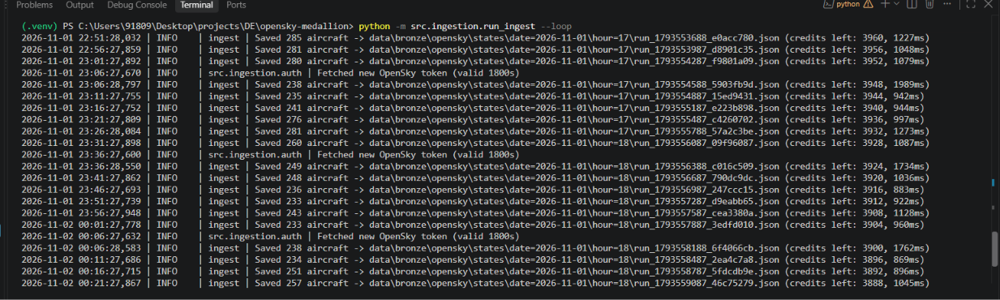
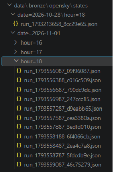

# OpenSky Medallion – Live Flight Data Pipeline

End-to-end data engineering project: live aircraft positions over India from the
OpenSky Network API, processed through **Bronze → Silver → Gold** layers.

**Current stage: Week 1 – Bronze ingestion (local)**

```
OpenSky API ──(every 5 min)──► run_ingest.py ──► data/bronze/opensky/states/date=…/hour=…/run_*.json
                                 │
                                 ├─ OAuth2 token cache + auto-refresh
                                 ├─ retries: 5xx backoff, 429 wait, 401 re-auth
                                 └─ metadata envelope (run_id, record_count, credits left…)
```

## Project structure

```
opensky-medallion/
├── src/
│   ├── common/
│   │   ├── config.py          # settings from .env, India bounding box
│   │   └── logger.py
│   └── ingestion/
│       ├── auth.py            # OAuth2 client-credentials token manager
│       ├── opensky_client.py  # /states/all with retry + rate-limit handling
│       ├── writer.py          # raw JSON → partitioned Bronze folder
│       ├── run_ingest.py      # entry point (once or --loop)
│       └── inspect_bronze.py  # see what landed
├── tests/test_ingestion.py    # mocked API tests, no network needed
├── .env.example
└── requirements.txt
```

---

## Week 1 plan (Oct 29 – Nov 4, 1–2 hrs/day)

### Day 1 – Thu Oct 29: Tools and repo
1. Install **Python 3.11+**, **Git**, **VS Code**, and **Docker Desktop** (Docker is needed from Week 2; install now so it's ready).
2. Create an empty GitHub repo named `opensky-medallion` (public – it's your portfolio).
3. Unzip this project, then:
   ```bash
   cd opensky-medallion
   git init && git add . && git commit -m "Week 1 starter"
   git branch -M main
   git remote add origin https://github.com/<your-username>/opensky-medallion.git
   git push -u origin main
   ```
4. Create a virtual environment and install packages:
   ```bash
   python -m venv .venv
   # Windows:      .venv\Scripts\activate
   # Mac / Linux:  source .venv/bin/activate
   pip install -r requirements.txt
   ```
5. Run the tests – they use fake responses, so they pass without an account:
   ```bash
   pytest -v
   ```
   ✅ Done when: 7 tests pass and the code is on GitHub.

### Day 2 – Fri Oct 30: OpenSky account and token
1. Register at opensky-network.org, then open your **Account** page and create an **API client**. Copy the client ID and secret.
2. `cp .env.example .env` (Windows: `copy .env.example .env`) and paste both values in. `.env` is git-ignored.
3. Get a token by hand once, so you understand OAuth2 client credentials (use Git Bash on Windows):
   ```bash
   curl -s -X POST "https://auth.opensky-network.org/auth/realms/opensky-network/protocol/openid-connect/token" \
     -d "grant_type=client_credentials" -d "client_id=YOUR_ID" -d "client_secret=YOUR_SECRET"
   ```
   Note `access_token` and `expires_in` in the reply.
4. Read `src/ingestion/auth.py` and match it to what you just did.
   ✅ Done when: you get a token back, and can explain why we refresh 60s before expiry.

### Day 3 – Sat Oct 31: First real API call
1. Run one ingestion:
   ```bash
   python -m src.ingestion.run_ingest
   ```
2. Open the JSON file it created under `data/bronze/…` and look at `metadata` and `payload.states`.
3. Read `opensky_client.py`. Understand the four cases: 200, 401, 429, 5xx.
   ✅ Done when: a Bronze file exists with a few hundred aircraft in it.

### Day 4 – Sun Nov 1: Understand the Bronze design
1. Read `writer.py`. Write answers in your own notes (interview prep):
   - Why store the payload **untouched**? (replay, audit, schema changes)
   - Why partition by `date=/hour=`? (Spark partition pruning in Week 3)
   - Why write to `.tmp` then rename? (atomic writes – no half-read files)
   - Why a metadata envelope? (lineage: run_id, record_count, credits left)
2. Run `python -m src.ingestion.inspect_bronze` to see the 17 state-vector fields decoded.
   ✅ Done when: you can explain each Bronze design choice in one sentence.

### Day 5 – Mon Nov 2: Failure handling
1. Read the tests in `tests/test_ingestion.py`, one per failure case.
2. Break things on purpose and watch the logs:
   - Put a wrong secret in `.env` → token request fails with a clear error.
   - Set `OPENSKY_API_BASE_URL=https://opensky-network.org/apix` → 404, not retried.
3. Restore `.env`. Add one test of your own (idea: 401 → token refresh → 200).
   ✅ Done when: your new test passes.

### Day 6 – Tue Nov 3: Collect real data
1. Start the loop and leave the laptop on for a few hours:
   ```bash
   python -m src.ingestion.run_ingest --loop
   ```
2. Run `python -m src.ingestion.inspect_bronze`. Check:
   - runs are ~5 minutes apart
   - aircraft count changes by time of day
   - `credits_left` drops by a few per call (you have ~4,000/day)
   ✅ Done when: you have 20+ runs of data saved.

### Day 7 – Wed Nov 4: Document and push
1. Add to this README: one paragraph "What I learned in Week 1" and a screenshot of the logs.
2. Commit and push:
   ```bash
   git add . && git commit -m "Week 1: Bronze ingestion complete" && git push
   ```
   ✅ Done when: the repo on GitHub shows the code, tests and your notes.

---

### What I learned in Week 1

1. **Project setup:** created the GitHub repo and a Python virtual environment, and ran
   the test suite with `pytest`. The tests use mocked API responses, so they pass without
   network access.
2. **OAuth2 client credentials:** created an API client in my OpenSky account and swapped
   its client ID and secret for a short-lived access token. `auth.py` caches the token
   and refreshes it 60 seconds before it expires, so no request is sent with an expired token.
3. **First live API call:** ran the ingestion job against `/states/all` with the India
   bounding box and checked that the raw JSON landed in the Bronze folder.
4. **Bronze layer design:**
   - The API response is stored untouched, so it can be replayed and audited.
   - Files are partitioned by `date=/hour=`, so later jobs read only the folders they need.
   - Each file is written to a `.tmp` name and then renamed, so no reader sees a half-written file.
   - A metadata envelope records `run_id`, record count and credits left, for lineage.
5. **Failure handling and tests:** went through how the client handles each response type:
   - 5xx: retry with exponential backoff
   - 429: wait for the `Retry-After` time
   - 401: get a new token and retry
   - Other 4xx: fail without retrying

   Each case has a matching unit test.
6. **Scheduled collection:** ran the job in `--loop` mode every 5 minutes and collected
   28 Bronze files, saved in date/hour partitions.




## Interview talking points from Week 1
- OAuth2 client-credentials flow with proactive token refresh
- Rate-limit handling (credit budget, `429` + `Retry-After`)
- Idempotent, immutable raw layer with lineage metadata
- Hive-style partitioning and atomic file writes
- Testable design: HTTP session and `sleep` injected, so tests run without network

---

## Week 2 plan (Nov 5 – Nov 11, 1–2 hrs/day): MinIO + Airflow

Goal: move the Week 1 job out of your terminal and into a scheduled, monitored pipeline.

```
Airflow (ingest_bronze_dag, */5 min)
   └─ task: ingest_once()
        ├─ OpenSkyClient.get_states()          (unchanged from Week 1)
        ├─ MinioBronzeWriter.write()   ──►  s3://bronze/opensky/states/date=…/hour=…/run_*.json
        └─ audit row               ──►  Postgres: pipeline_runs
```

All services run in one `docker-compose.yml`: **MinIO**, **Postgres** (holds the audit table
and Airflow's own metadata DB), and the **Airflow** scheduler and web UI.

> Windows: Docker Desktop needs the WSL2 backend and **at least 4 GB of RAM** for Airflow
> (Settings → Resources). Check this before Day 1.

### Day 1 – Thu Nov 5: Docker and MinIO
1. Learn the core Docker ideas: image, container, volume, port mapping, `docker compose up -d / down / logs`.
2. Create `docker-compose.yml` with **only MinIO** for now: ports `9000` (API) and `9001` (web console), and a named volume so data survives restarts.
3. Open http://localhost:9001, log in, and create a bucket called `bronze`.
4. Upload one Week 1 JSON file by hand and find it in the console.
   ✅ Done when: MinIO runs in Docker and the `bronze` bucket exists.

### Day 2 – Fri Nov 6: MinIO writer
1. Add `boto3` to `requirements.txt`. MinIO speaks the S3 API, so the same code later works on AWS S3. ADLS Gen2 in Week 5 needs its own SDK, but the design stays the same.
2. In `writer.py`, add `MinioBronzeWriter` with the **same `write()` signature** as `LocalBronzeWriter`, and the same object key layout: `opensky/states/date=…/hour=…/run_<epoch>_<runid>.json`.
3. Add settings to `config.py` and `.env.example`: `BRONZE_BACKEND=local|minio`, `MINIO_ENDPOINT`, `MINIO_ACCESS_KEY`, `MINIO_SECRET_KEY`, `MINIO_BUCKET`. `run_ingest.py` picks the writer from `BRONZE_BACKEND`.
4. Add `tests/bronze/test_minio_writer.py` with a mocked S3 client to check the key and the envelope.
5. Run `python -m src.ingestion.run_ingest` with `BRONZE_BACKEND=minio` and find the object in the console.
   ✅ Done when: one live run lands in MinIO and the new test passes.
   💡 Interview note: an S3 `PUT` is atomic, so this writer doesn't need the `.tmp` + rename step from Week 1.

### Day 3 – Sat Nov 7: Postgres and the audit table
1. Add **Postgres** to `docker-compose.yml`.
2. Create `sql/pipeline_runs.sql` (run automatically on first start via `/docker-entrypoint-initdb.d`), with these columns:

   | column | meaning |
   |---|---|
   | `run_id` (PK) | same id as in the Bronze envelope, for lineage |
   | `started_at`, `finished_at` | UTC timestamps |
   | `status` | `success` / `skipped` / `failed` |
   | `record_count` | aircraft in the snapshot |
   | `credits_left` | from `X-Rate-Limit-Remaining` |
   | `object_key` | where the file landed |
   | `error` | message when not `success` |

3. Make `ingest_once()` insert one row per run, **including failed and skipped runs**. Those rows matter most.
   ✅ Done when: `SELECT * FROM pipeline_runs ORDER BY started_at DESC;` shows your runs.

### Day 4 – Sun Nov 8: Airflow in Docker
1. Add Airflow from the official `apache/airflow` image, using **LocalExecutor**. Skip the Celery/Redis setup from the official example because it's too heavy for a laptop.
2. Use a separate `airflow` database on the same Postgres container for Airflow's metadata.
3. Mount `./dags` and `./src` into the containers, and pass the OpenSky and MinIO settings in from `.env`.
4. Open the Airflow UI at http://localhost:8080 and log in.
   ✅ Done when: `docker compose ps` shows every service as healthy, and you can explain why Airflow needs its own database.

### Day 5 – Mon Nov 9: The Bronze DAG
1. Create `dags/ingest_bronze_dag.py` with these settings:
   - `schedule="*/5 * * * *"`
   - `catchup=False`: the API only returns the current snapshot, so there's nothing to backfill.
   - `max_active_runs=1`: two runs never overlap.
   - `retries=2`, `retry_delay=1 min`
2. The single task builds the client and writer, then calls `ingest_once()`.
   - On a skipped run (rate-limited), raise `AirflowSkipException` so the task shows as *skipped*, not green.
   - On a real failure, raise so Airflow retries it.
3. Turn the DAG on and watch the first runs in the Grid view, then open the task logs.
   ✅ Done when: a new MinIO object and a new `pipeline_runs` row appear every 5 minutes with no manual steps.

### Day 6 – Tue Nov 10: Run it and break it
1. Leave the stack running for a few hours.
2. Check health with SQL:
   ```sql
   -- success rate and credits used today
   SELECT status, count(*), min(credits_left) FROM pipeline_runs
   WHERE started_at::date = current_date GROUP BY status;

   -- gaps longer than 6 minutes between runs
   SELECT started_at, started_at - lag(started_at) OVER (ORDER BY started_at) AS gap
   FROM pipeline_runs ORDER BY gap DESC NULLS LAST LIMIT 5;
   ```
3. Break things on purpose:
   - `docker compose stop minio` → the task retries, then fails, and the audit row shows `failed`. Start MinIO again.
   - Put a wrong secret in `.env` → you get a clear auth error in the task log.
   ✅ Done when: you can explain what Airflow and `pipeline_runs` showed for each failure.

### Day 7 – Wed Nov 11: Document and push
1. Update the architecture diagram at the top of this README, and add "What I learned in Week 2" with screenshots of the Airflow Grid view, the MinIO console and the `pipeline_runs` query.
2. Make sure `.env` is still ignored, and that no MinIO or Postgres passwords are hard-coded in `docker-compose.yml` (read them from `.env`).
3. Commit and push: `git commit -m "Week 2: Airflow + MinIO Bronze pipeline"`.
   ✅ Done when: someone can clone the repo, fill in `.env`, run `docker compose up -d`, and see data arrive.

### Interview talking points from Week 2
- Orchestration vs scheduling: retries, `catchup`, `max_active_runs`, and task states
- Object storage and the S3 API; why atomic `PUT` replaces tmp + rename
- Pipeline observability: an audit table that logs failed runs too, not just successes
- Swappable writer design: same `write()` for local, MinIO, and (Week 5) ADLS
- Containerised local stack that maps to Azure: MinIO → ADLS Gen2, Airflow → ADF

## Next: Week 3
PySpark + Delta Lake Silver layer: read new Bronze partitions from MinIO, flatten, dedupe and MERGE.
